

  

<h1 align="center">✿ Paracosm ✿</h1>
<h3 align="center">All your worlds. One little place</h3>

  A personal media archive to collect, organize, track, and revisit everything you love.

  <a href="[PARACOSM](https://paracosmn.netlify.app/)">Live Demo</a>

  
  
  
  

---

## ♡ About

**Paracosm** is a personal media management application designed to bring all your fictional worlds into one little home.

Whether it's books, movies, TV shows, anime, manga, fanfiction, or other media, Paracosm gives you a space to archive your favourites, organize collections, track your progress, and keep personal notes.

Think of it as your own little corner of the internet dedicated to everything you love.

## ✧ Features

- **Personal Media Archive** — Add, edit, and organize media across multiple categories.
- **Metadata Search** — Find and import media details and cover artwork through external APIs.
- **Collections & Shelves** — Create custom collections to organize your archive.
- **Progress Tracker** — Keep track of what you're reading, watching, playing, or have completed.
- **Personal Notes** — Save your thoughts and notes about individual media entries.
- **Statistics Dashboard** — Visualize your archive and activity.
- **Activity Timeline** — Revisit your media journey.
- **Progressive Web App** — Install Paracosm on supported devices.

## ⊹ Screenshots

<strong>01 · First impressions</strong>

<table align="center">
  <tr>
    <td align="center">
      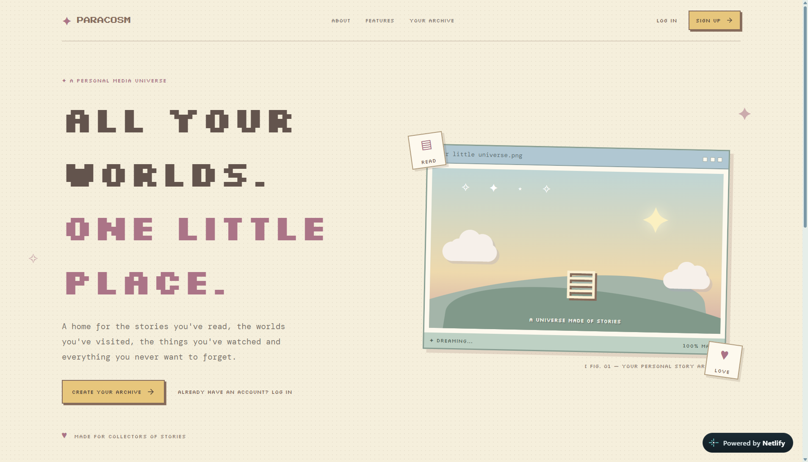
       Landing Page
    </td>
    <td align="center">
      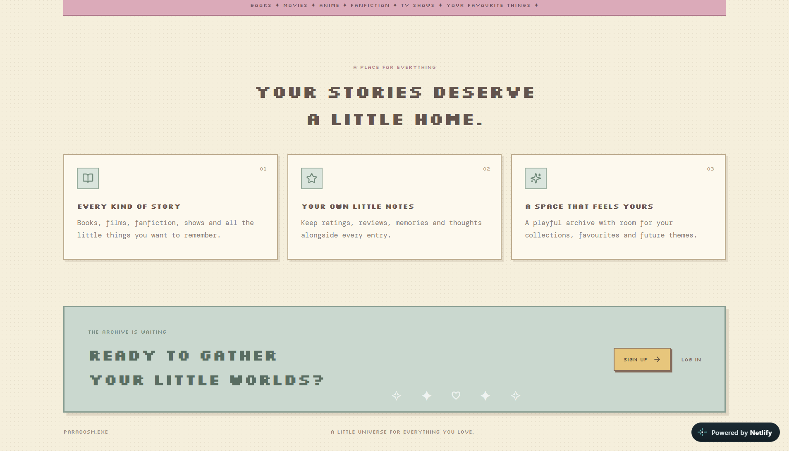
       Explore Paracosm
    </td>
  </tr>
  <tr>
    <td align="center">
      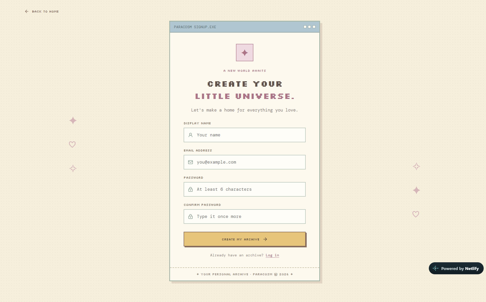
       Sign Up
    </td>
    <td align="center">
      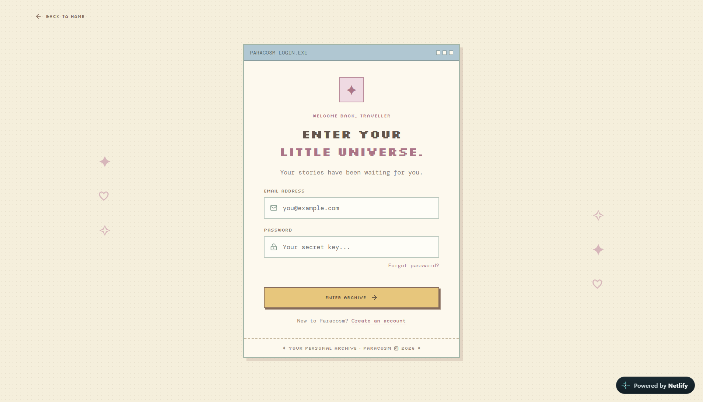
       Login
    </td>
  </tr>
</table>

<strong>02 · Your personal archive</strong>

<table align="center">
  <tr>
    <td align="center">
      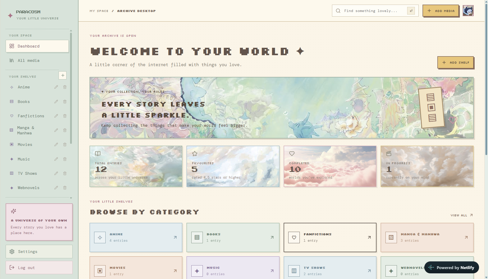
       Dashboard
    </td>
    <td align="center">
      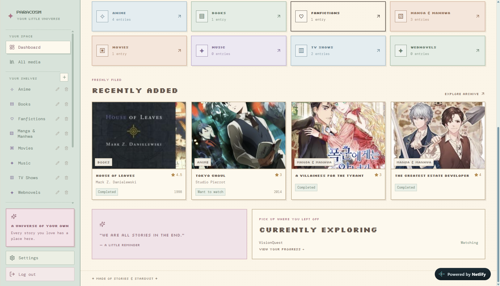
       Media Overview
    </td>
  </tr>
  <tr>
    <td align="center">
      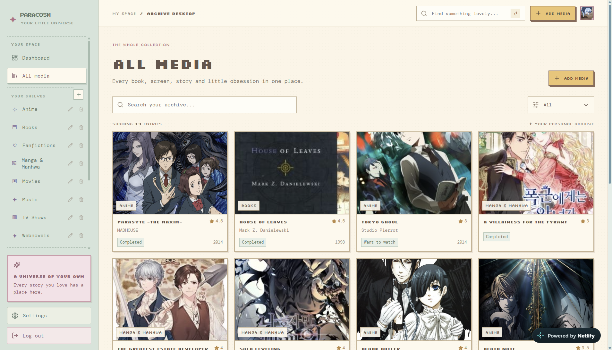
       All Media
    </td>
    <td align="center">
      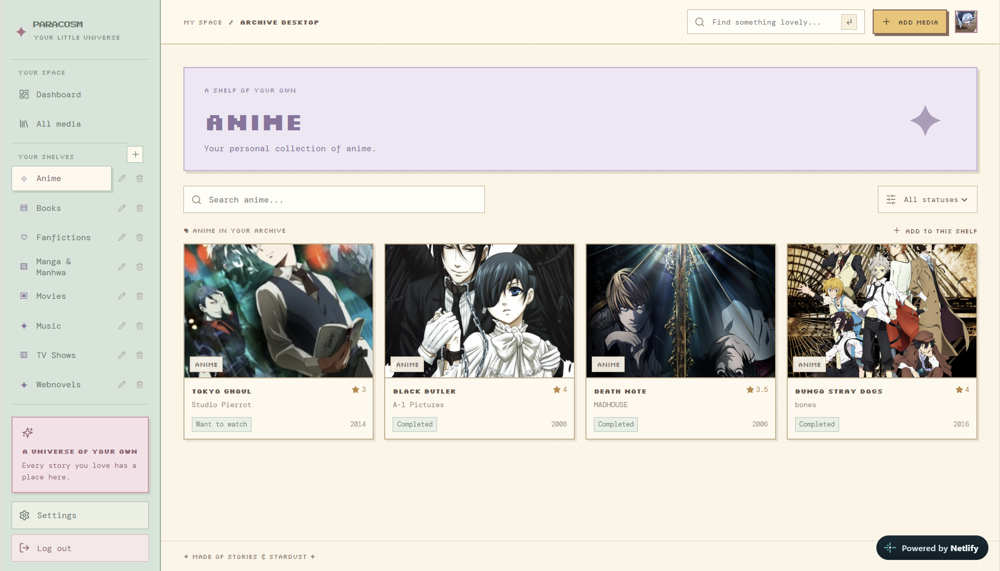
       Anime
    </td>
  </tr>
  <tr>
    <td align="center">
      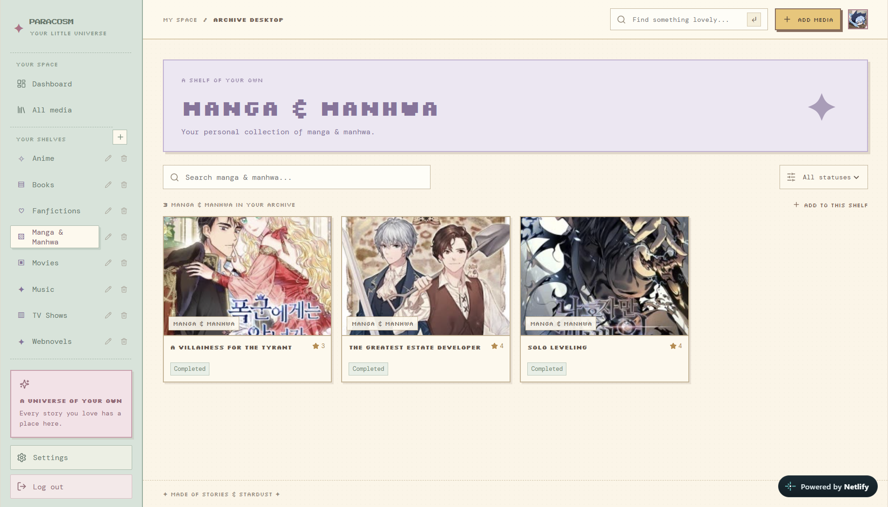
       Manga
    </td>
    <td align="center">
      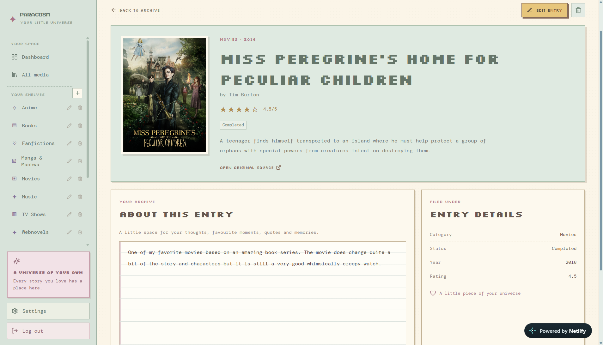
       Item Details
    </td>
  </tr>
</table>

<strong>03 · Build your collection</strong>

<table align="center">
  <tr>
    <td align="center">
      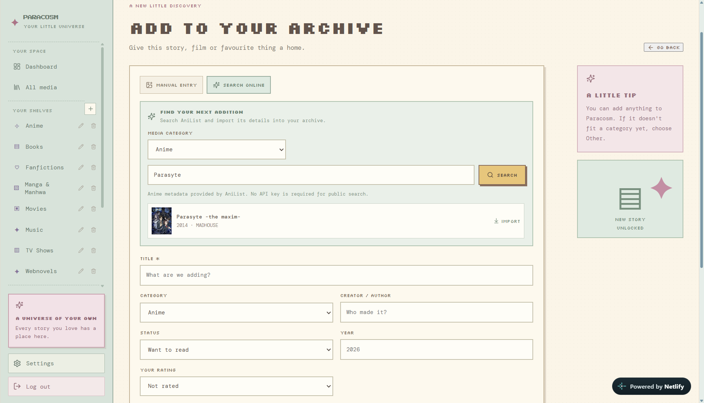
       Add Media
    </td>
    <td align="center">
      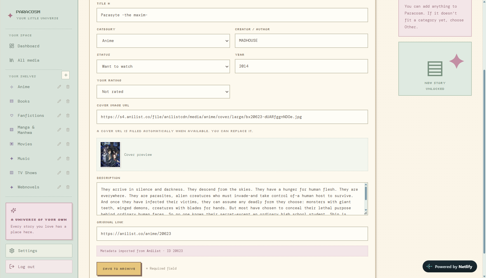
       Imported Details
    </td>
  </tr>
  <tr>
    <td align="center">
      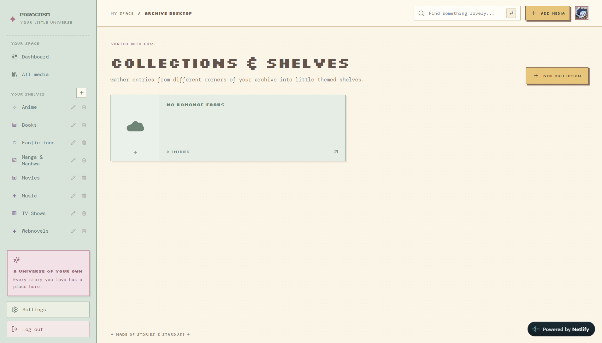
       Collections & Shelves
    </td>
  </tr>
</table>

<strong>04 · Your media journey</strong>

<table align="center">
  <tr>
    <td align="center">
      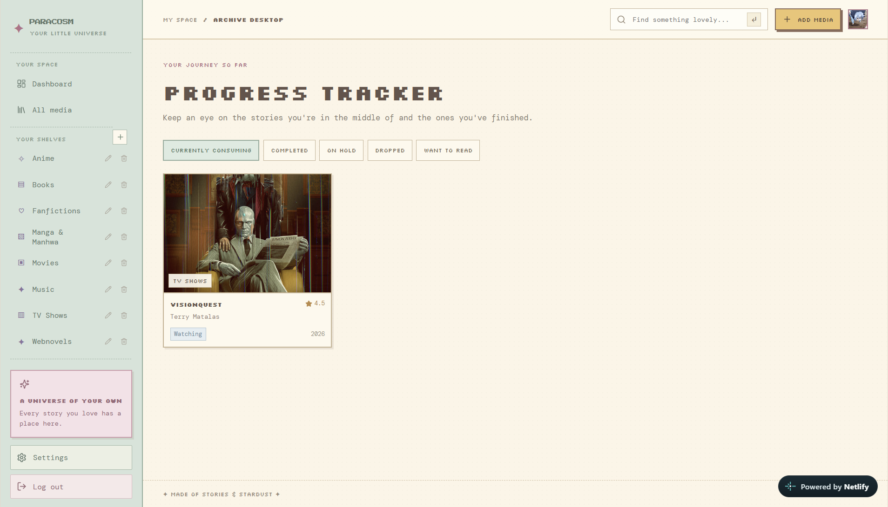
       Progress Tracker
    </td>
    <td align="center">
      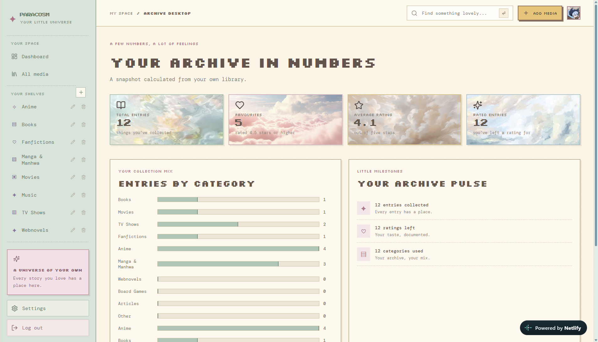
       Statistics
    </td>
  </tr>
  <tr>
    <td align="center">
      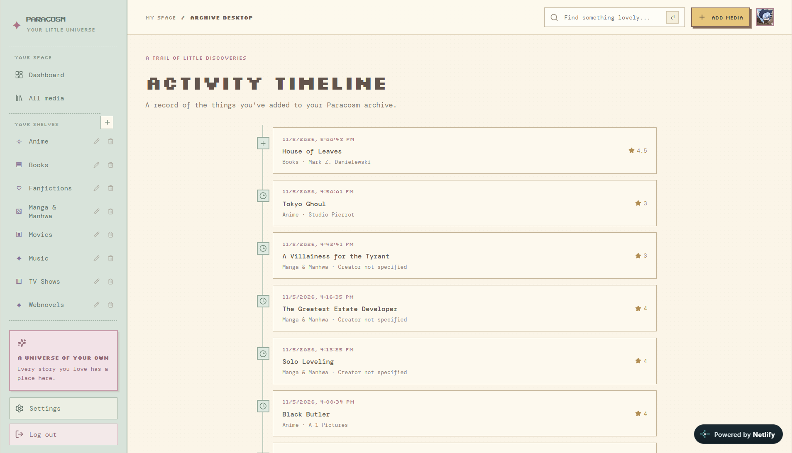
       Activity Timeline
    </td>
    <td align="center">
      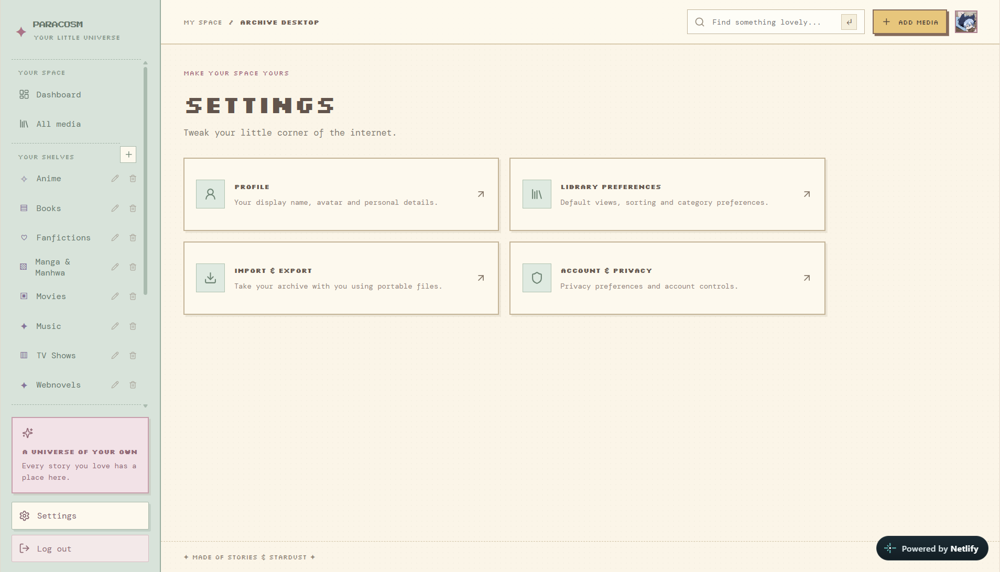
       Settings
    </td>
  </tr>
</table>

## ⚙️ Tech Stack

| Technology | Purpose |
|---|---|
| React | Frontend UI |
| Vite | Development and build tooling |
| Supabase | Database and authentication |
| JavaScript | Application logic |
| CSS | Styling and responsive layouts |
| Vite PWA Plugin | PWA support |

### External APIs

- [AniList API](https://anilist.gitbook.io/anilist-apiv2-docs/) — Anime and manga metadata.
- [TMDB API](https://developer.themoviedb.org/docs) — Movie and TV metadata.
- [Open Library API](https://openlibrary.org/developers/api) — Book metadata and covers.
- [Comick Source API](https://comick-source-api.notaspider.dev/) — Manga search.

  Made with ♡ by Manasvi Naik

